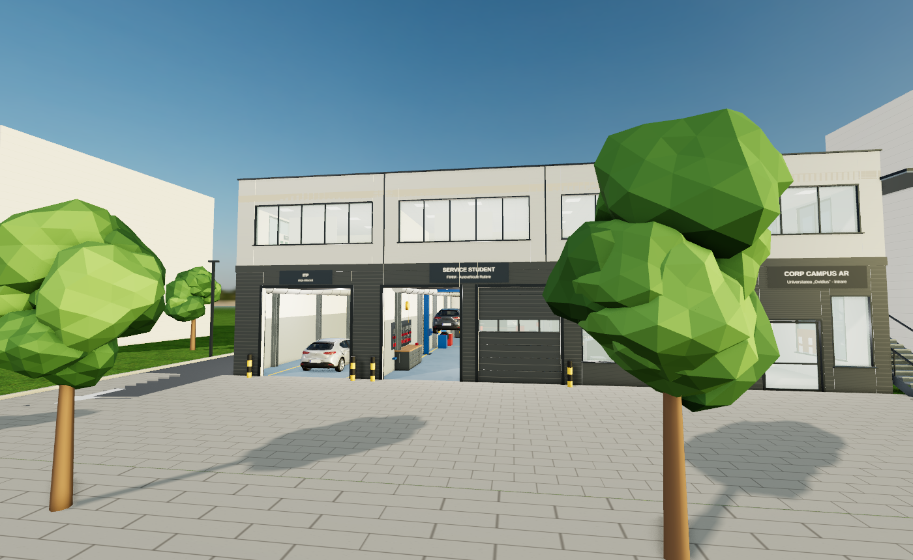
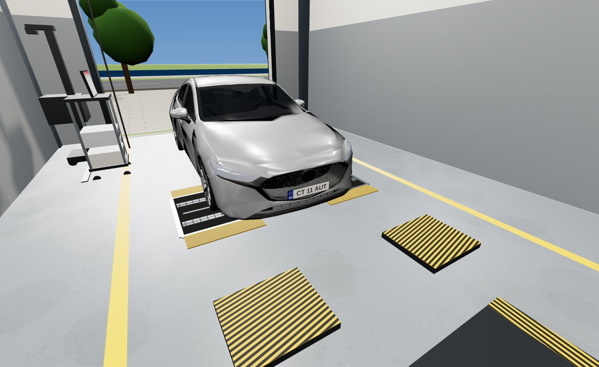

# Corp Campus AR – explorare 3D (lot 21 + lot 18)

Aplicație web 3D la persoana întâi pentru clădirea Corp Campus AR (25 × 20 m = 500 m², P+1) a Universității „Ovidius” din Constanța. Clădirea e amplasată pe lotul 21, cu parcarea pe lotul 18, la capătul opus față de stradă și lac. Se pot explora:

* stația ITP (P01);
* Service-ul Student (P02);
* toate laboratoarele;
* scara exterioară S1 și liftul.

## Comenzi

| Tastă / mouse | Acțiune |
|---|---|
| Săgeți ↑ ↓ ← → sau W A S D | deplasare (← → rotesc privirea) |
| Clic + trage cu mouse-ul | privire |
| Shift | mers rapid |
| Clic / privire pe un echipament | fișa echipamentului: disciplina, lucrările, sursa |
| E | liftul (parter ↔ etaj) |
| 1 – 9 | teleport în încăperi (lista din dreapta) |
| M | harta mică · H ascunde panoul cu taste |
| C / N | mărește imaginea concept a încăperii / trece la următoarea |
| Q | comută între calitate înaltă (ocluzie ambientală, antialiasing) și calitate rapidă |

Pe scară se urcă mergând pe trepte. Ușile se deschid singure când te apropii.

### Organizare (500 m²)

* **Parter:**
  * **P01 Stație ITP clasa a II-a (≤ 3,5 t), 80 m²:** 5,8 × 13,8 m. Lățimea depășește minimul RNTR 1 de 4,5 m pentru clasa a II-a, iar canalul de vizitare are 6,5 m (minimul este 6 m). Spațiul e separat de celelalte activități. Accesul vehiculelor se face din parcare, prin poarta din spate.
  * **P02 Service student, 113 m² + magazie piese 5,5 m²:** 2 posturi marcate (elevator cu 2 coloane și post la sol), acces din parcare. Lucrările se pot urmări pe un monitor din holul de intrare, conform RNTR 9.
  * **P03 Laborator motoare, 176 m²:** în formă de L, cu vitrină mare spre stradă, aripă estică pentru standurile de motor și ușă de echipamente spre parcare.
  * **Fâșia de est:** hol de intrare din stradă, vestiar, WC-uri și cameră tehnică.
* **Etaj:** E01–E05, E12 Sală CAD (15 posturi PC), E13 Sală de protocol (întâlniri oficiale, ședințe), grupuri sanitare.
* **Fațada:** e tratată ca o clădire universitară: fibrociment deschis și grafit, cadru alb în consolă, copertină la intrare, accente turcoaz. Scara S1 are ecran de lamele, balustradă din sticlă și trepte placate cu HPL.

### Capacitate maximă conform ARACIS și locuri amenajate

Suprafața netă = suprafața încăperii (din plan) − amprenta standurilor didactice și a echipamentelor de pe pardoseală (proiecția lor în plan, calculată din model). Numărul maxim de locuri = ⌊ netă / normă ⌋, după Metodologia ARACIS (partea I, std. 1.4.1.6 / 1.4.3.6): laboratoare cu caracter tehnic ≥ 4 m²/loc, laboratoare de informatică ≥ 2,5 m²/loc. Mesele și scaunele se amplasează automat (`seatLabs()` în `js/equipment.js`) în spațiul liber, cu 0,5 m de lucru în jurul standurilor și 1 m liber în fața ușilor. În P01 (ITP), P02 (service) și P03 (laborator motoare) nu se pun mese automat (în P03 sunt 4 bănci puse manual, în locul machetei Smart). E13 a devenit sală de protocol. Valorile apar pe plăcuțele ușilor și în bara cu numele încăperii.

| Încăpere | Suprafață | Standuri / echipamente | Netă | Normă | Locuri max. | Amenajate |
|---|---|---|---|---|---|---|
| P01 Stație ITP | 80,0 m² | 21,1 m² | 59,0 m² | 4 | 14 | – (fără mese) |
| P02 Service student | 115,9 m² | 38,0 m² | 77,9 m² | 4 | 19 | – (fără mese) |
| P03 Laborator motoare | 176,6 m² | 18,7 m² | 157,9 m² | 4 | 39 | – (fără mese) |
| E01 Diagnosticare + Mecatronică | 55,3 m² | 8,5 m² | 46,8 m² | 4 | 11 | 11 |
| E02 CCA | 55,4 m² | 8,7 m² | 46,6 m² | 4 | 11 | 11 |
| E03 Dinamică | 55,3 m² | 16,4 m² | 38,9 m² | 4 | 9 | 6 |
| E04 Caroserii | 64,4 m² | 10,8 m² | 53,6 m² | 4 | 13 | 13 |
| E05 HeV | 64,4 m² | 6,8 m² | 57,6 m² | 4 | 14 | 13 |
| E12 Sală CAD | 41,7 m² | 0 | 41,7 m² | 2,5 | 16 | 15 |

### Trasee din stradă

* **Vehicule:** pe aleea laterală de vest ajungi în parcarea din spate, iar de acolo intri prin porțile ITP și service.
* **Intrare pietonală:** ușa principală e pe fațadă, în dreapta, și duce în holul de intrare P04, apoi pe coridor la vestiar și WC. Laboratorul de motoare are și o ușă proprie spre stradă.
* **Etaj:** scara exterioară S1 pornește de la fațada principală, din capătul aleii de acces pavate, și urcă în linie dreaptă până la podestul +4,80, de unde intri în holul etajului și apoi în fiecare laborator. Alternativ, liftul (tasta E).

## Publicare pe GitHub Pages

1. Creează un repository nou (de ex. `corp-campus-ar-3d`).
2. Încarcă **tot conținutul acestui folder** în rădăcina repository-ului: `index.html`, `css/`, `js/`, `lib/`, `.nojekyll`.
3. Deschide **Settings → Pages → Build and deployment**, alege *Deploy from a branch*, apoi branch-ul `main` și folderul `/ (root)`, și apasă **Save**.
4. După 1–2 minute aplicația e disponibilă la `https://<utilizator>.github.io/corp-campus-ar-3d/`.

Aplicația nu are dependențe externe: Three.js r160 e inclus în `lib/`, iar texturile se generează procedural. Funcționează și offline. Local se rulează cu `python -m http.server`, apoi se deschide `http://localhost:8000`. Dublu clic pe `index.html` nu merge, pentru că modulele ES au nevoie de un server.

## Imagini concept

Aspectul exterior și cel interior urmează imaginile concept din `img/concept/`:

* fațada: parter antracit și etaj gri deschis, ferestre în bandă, trei porți secționale (cea de la ITP deschisă), stâlpișori galben-negru, scară exterioară acoperită;
* parcarea pavată cu gard și arbuști;
* halele: soclu gri, marcaje galbene, corpuri LED liniare, tubulatură de ventilație, furtunuri de evacuare suspendate, bancuri cu panouri de scule;
* laboratoarele: mese cu blat de lemn.

În fiecare încăpere, imaginea concept corespunzătoare apare în colțul din stânga jos (clic sau tasta C o mărește).

## Sursa datelor

* **Geometria:** `Corp_Campus_Planuri_Editabile.dxf`, cu pereții, golurile, ușile, porțile și scara S1 la cotele din concept (parter +0,00, etaj +4,80, atic +8,60).
* **Echipamentele:** 82 de obiecte, amplasate după fișele de disciplină și materialele din folderul UOC 2026–2027. Printre surse:
  * caietul de sarcini pentru Laboratorul Motoare;
  * îndrumarele Diagnosticare și SAA;
  * inventarul de mecatronică;
  * standurile de diplomă.

  Fiecare obiect are fișa lui (disciplina, lucrările de laborator, documentul-sursă), afișată când îl privești.

| Încăpere | Discipline principale |
|---|---|
| P01 Linie ITP | Inspecție tehnică: frâne, suspensie, ripaj, faruri, analizor gaze, detector de jocuri |
| P02 Service student | Diagnosticare, practică, mentenanță: elevator 2 coloane, post la sol, X431, schimbător și echilibror de roți |
| P03 PCMAI + CCMAI | Motoare: stand Otto 1.4 MPI, Diesel 1.5 dCi, AVL DiTEST, machetă secționată Smart |
| E01 | Diagnosticare + Mecatronică: 4 standuri mobile de mecatronică și un stand de diagnoză (inserare defecte + breakout OBD), refăcute după proiectul propriu (cadru 1700×1000×800, tablă perforată, ST1–ST12, BB1–BB5); motor diesel F1C 3.0 pe stand rotativ, cu agregate și cablaj; mese de laborator cu laptop, osciloscop, placă de achiziție și multimetru; 2 cursanți la mese; rețea CAN, stand injectoare |
| E02 | Construcția autovehiculelor: ambreiaje și cutie de viteze secționate, McPherson, casetă de direcție, punte motoare, sisteme de frânare, raft pneuri |
| E03 | Dinamica autovehiculelor: post de simulare dinamică, cântare de roți, stand de frânare hidraulică instrumentat |
| E04 | Caroserii: caroserie în alb, ușă pe stand, braț de măsurare, crash-box-uri, post CAD |
| E05 | Autovehicule hibride și electrice: machetă baterie ≤ 60 V cu BMS, motor electric, wallbox, transmisie hibridă secționată |

Autoturismele folosesc un model 3D real: „2020 Mazda 3 Hatchback” de OUTPISTON (Sketchfab), licență [CC BY-NC-SA 4.0](https://creativecommons.org/licenses/by-nc-sa/4.0/), în varianta fără sigle pregătită de proiectul freaxnx01/game-rhyflitzer (detalii în `models/hatchback.LICENSE.md`). Licența permite doar utilizare necomercială, cu atribuire. Cerul și reflexiile exterioare folosesc panorama HDR „Quarry 01” de la Poly Haven (CC0), iar gazonul folosește textura din exemplele three.js. Celelalte echipamente sunt modelate simplificat (volumetrie la scară reală, materiale PBR, lumină naturală și artificială). Nu sunt modele foto-realiste ale mărcilor concrete.

